# Architecture and mappings

## Pipeline

The [context-specific retrieval](context-workflow.md) workflow supports batch selection in version 0.7.0: `get-environments` creates Nodes, `get-solutions` requires selected environment Nodes, and `get-*` component scripts require selected solution Application Components. `get-plugins` also accepts selected table Data Objects; a batch must contain one context type. `context.js` validates every selected concept before authentication, `scoped.js` collects and combines bounded solution membership/metadata before resolving references, and `scoped-app.js` coordinates a single preview/application for the batch. Most imported concepts reside in the Application layer, including solution Application Components, flow Application Processes, plug-in Application Functions and table/view Data Objects.

The original environment-wide pipeline remains available:

```mermaid
flowchart LR
  CLI[Azure CLI user session] --> AUTH[Per-audience token cache]
  AUTH --> DISC[Environment API and Dataverse discovery]
  DISC --> PICK[Searchable environment multi-select]
  PICK --> INV[Resource Graph inventory]
  PICK --> DV[Dataverse metadata and dependencies]
  INV --> NORMAL[Normalized objects and source aliases]
  DV --> NORMAL
  NORMAL --> ROLES[Custom-role review]
  ROLES --> META[Enrich supported element properties]
  META --> PLAN[Reconciliation and relationship validation]
  PLAN --> PREVIEW[Preview and Apply decision]
  PREVIEW --> ARCHI[jArchi and undoable Archi model commands]
```

`lib/core.js` defines identities, metadata properties and options. `auth.js`, `cli-java.js`, `java-runtime.js` and `http.js` handle local sign-in and read-only transport. `inventory.js` and `dataverse.js` collect metadata; `plugins.js` reads plug-in types and registrations; `metadata.js` defines the property catalogue and enriches observed objects. `dependencies.js` resolves explicit IDs. `service.js` coordinates collection. `planner.js` computes changes without mutating a model. `archi-adapter.js` applies the reviewed changes. `ui.js` supplies native checkbox dialogs; `app.js` coordinates the interactive workflow.

Runtime modules are plain JavaScript loaded by jArchi/GraalJS. The production path needs no Node.js process, PowerShell module, database, web server or additional Java library. The CLI diagnostic reuses the same collection and normalization code with a Node transport adapter.

## Identity and scope

Canonical identity is `tenantId|environmentId|kind|sourceObjectId`. Tenant is an internal collision boundary and metadata property; it creates no folder or element. Environment ID, rather than environment name or development stage, defines the import scope. Architecture stages are user annotations and never merge environments.

Resource Graph and Dataverse sometimes provide different identifiers. For example, canvas app inventory IDs and Dataverse primary IDs can differ; flows can also have runtime and workflow IDs. `PowerPlatform-SourceIds` retains known aliases, and `PowerPlatform-DataverseId` stores the proven primary ID separately. Reconciliation preserves a previous canonical identity whenever those aliases match unambiguously. Ambiguous matches abort before Apply.

Role copies across business units are grouped by root role ID within one environment. Their IDs remain aliases for app access associations. Business units themselves are not imported.

## Relationship semantics

| Direction | ArchiMate relationship | Evidence |
| --- | --- | --- |
| Environment → solution/app/flow/agent/plug-in | Serving | Explicit environment membership |
| Parent flow → child flow | Triggering | Static Workflow action reference in `workflow.clientdata` |
| Flow → agent | Serving | Dataverse `botcomponent_workflow` and parent/associated bot IDs |
| Dependent app/flow → required app/flow | Association | Dataverse solution dependency record; does not assert runtime execution |
| Security role → model-driven app | Association | `appmoduleroles_association`; describes app access configuration, not a user assignment |
| Solution → app/flow/agent | Aggregation | Explicit solution membership |
| Solution → table/view | Association | Explicit or table-root-inherited solution membership |
| View → table | Association | `savedquery.returnedtypecode`; metadata relationship, not a query execution |
| Plug-in → registered table | Access (unspecified read/write) | Processing step → SDK message filter primary table |
| Solution → plug-in Function | Association | Plug-in type, assembly or processing-step membership |

All mappings are checked with jArchi's relationship validator before application. `PowerPlatform-InteractionKind` and `PowerPlatform-Evidence` retain the source, field and owner of each observation. A relationship with several observations retains evidence from unavailable collectors rather than losing it on a partial run.

Only explicit IDs resolve to endpoints. A flow and an app using the same connector are not sufficient evidence of a link. Dynamic expressions, external URLs and unresolved component references remain diagnostic items. Evidence does not claim that a configured interaction has actually run.

## Ownership and lifecycle

Managed concepts, folders and relationships use `PowerPlatform-ManagedBy=archi-powerplatform-sync`. Existing unowned objects are never claimed by name. Matching manual relationships between imported endpoints are reused without changing their name or properties.

Lifecycle properties follow the Azure tool's convention: `CreatedDate`, `CreatedTime`, `LastSyncDate`, `LastSyncTime`, `IsDeleted`, `DeletedDate`, `DeletedTime`. Additional observation properties distinguish observed, confirmed missing and missing/unverified objects. Repeated runs retain Archi GUIDs and original creation timestamps. Reappearance clears the deletion marker.

Deletion confirmation is scoped to selected environments and enabled collectors. It requires a complete current Dataverse collection, discovery reporting `IsUserSysAdmin`, a saved Dataverse primary ID and a current GET returning 404. A 403, timeout or failed page never confirms absence. Missing environments, inventory-only objects and code apps are retained without automatic deletion. Role deselection is an explicit scope reduction and preserves the old role and its links.

That object-deletion confirmation applies to the environment-wide workflow. Context scripts are non-destructive to absent objects: they can retire only completed relationship evidence, including the selected solution/type's membership. Membership owners include both solution identity and component kind, so shared components and other retrieval scopes remain independent. Existing imported endpoints can support new links without being updated as objects.

Managed roots are created under the appropriate Archi categories, without relying on localized category names. Existing manual folders named `PowerPlatform` cause a preflight conflict. Edit the configured root or rename the conflicting manual folder before applying. Other folder conflicts can be detected during Apply; use Undo if the apply step fails.

## Transport and data handling

Only metadata GETs and the Azure Resource Graph query POST are permitted. Tokens stay in memory, are scoped by audience and explicit tenant, and are cleared at the end of a run. No token is sent in a process argument or saved in a model. Redirects are rejected. Pagination must stay on the same origin and collection; repeated continuation tokens abort. Throttling and transient server errors receive bounded retries. Each response is capped at 32 MiB.

Flow definitions are processed in memory for static child-flow IDs and then discarded. Topic content, connection parameters, app packages, data records and role privilege matrices are not exported. Human-authored descriptive metadata is allowlisted and obvious accidental credential formats are redacted; this is not a general-purpose data-loss prevention system.
